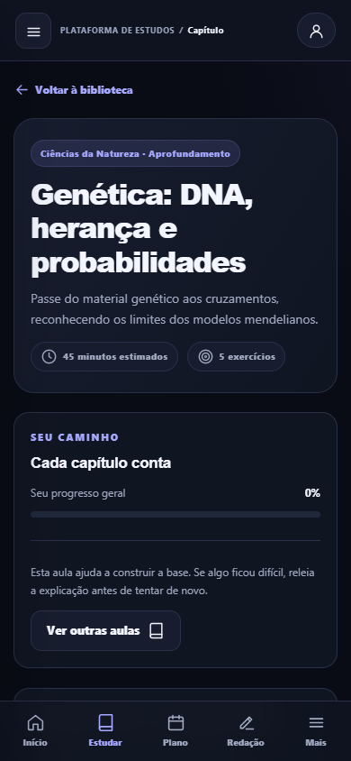

<div align="center">

<a href="https://appsmp.github.io/say.enem/">
  
</a>

<br>
<br>

**UM ESPAÇO PARA APRENDER. UM CAMINHO PARA CONTINUAR.**

# Seu próximo capítulo começa aqui.

Conteúdo, prática e organização para transformar a preparação para o ENEM<br>
em uma rotina que faz sentido — no celular e no computador.

<br>

[](https://appsmp.github.io/say.enem/)
[](https://appsmp.github.io/say.enem/#/biblioteca)

<br>


<br>

[A experiência](#a-experiência) · [Por dentro](#por-dentro-do-say) · [Conteúdo](#uma-biblioteca-quatro-áreas) · [Começar](#do-primeiro-acesso-ao-primeiro-progresso) · [Projeto](#para-quem-quer-explorar-o-projeto)

</div>

<br>

## A experiência

O Say nasceu de uma ideia pessoal: criar um lugar acolhedor para ajudar alguém especial a estudar para o ENEM. Um lugar para entender o conteúdo, praticar, escrever, revisar e voltar no dia seguinte com um próximo passo em mente.

A interface combina fundo escuro, tons de lavanda, cartões organizados e navegação adaptada à tela. O foco é dar espaço ao que importa: o estudo.

<br>

<table>
  <tr>
    <td align="center" width="72%"><strong>Uma visão clara do seu caminho</strong></td>
    <td align="center" width="28%"><strong>Seu estudo acompanha você</strong></td>
  </tr>
  <tr>
    <td valign="top"></td>
    <td valign="top"></td>
  </tr>
</table>

<p align="center"><sub>Capturas reais do projeto em modo local de demonstração. A interface também oferece tema claro.</sub></p>

<br>

## Por dentro do Say

| | Espaço | O que você encontra |
|:--:|:--|:--|
| ✦ | **Visão geral** | Progresso, atividades do dia, próximos capítulos e contagem regressiva para as provas configuradas. |
| 📖 | **Biblioteca** | Busca por assunto, filtros por área, objetivos, explicações e exemplos para construir a base. |
| 🧭 | **Plano de estudos** | Atividades que consideram a fase da prova, capítulos concluídos e resultados registrados. |
| 🎯 | **Questões e simulados** | Treino rápido com 8 questões ou mini-simulado com 12 questões e 20 minutos. |
| ✍️ | **Laboratório de redação** | 60 temas com orientação, editor, rascunhos salvos e checklist de revisão. |
| 🗂️ | **Flashcards** | Perguntas e respostas para recuperar conceitos antes de consultar a explicação. |
| 📊 | **Meu desempenho** | Acertos por área, capítulos concluídos e histórico dos treinos. |
| ⚙️ | **Configurações** | Tema claro ou escuro, meta diária, conta e exportação ou importação do progresso. |

<br>

### Feito para caber na sua rotina

<table>
  <tr>
    <td width="50%" valign="top">
      <h3>🌙 Conforto para estudar</h3>
      <p>Tema escuro por padrão, alternativa clara e conteúdo dividido em seções para facilitar a leitura.</p>
    </td>
    <td width="50%" valign="top">
      <h3>📱 Do celular ao computador</h3>
      <p>Navegação móvel e layout responsivo. Com a conta e o Supabase configurados, o progresso pode ser sincronizado entre dispositivos.</p>
    </td>
  </tr>
  <tr>
    <td valign="top">
      <h3>🧠 Praticar e compreender</h3>
      <p>Exercícios com gabarito e explicação, correção ao final dos treinos e flashcards para revisão ativa.</p>
    </td>
    <td valign="top">
      <h3>💾 Um registro do seu percurso</h3>
      <p>Salvamento local, acompanhamento do desempenho e backup em JSON para guardar uma cópia do progresso.</p>
    </td>
  </tr>
</table>

<br>

## Uma biblioteca, quatro áreas

| Área | Capítulos | Questões | Alguns dos assuntos |
|:--|:--:|:--:|:--|
| **Linguagens** | 9 | 24 | Interpretação, argumentação, variação linguística, literatura, arte, inglês e espanhol. |
| **Ciências Humanas** | 11 | 30 | História do Brasil, industrialização, cidadania, cartografia, clima, filosofia e sociologia. |
| **Ciências da Natureza** | 15 | 66 | Ecologia, genética, evolução, fisiologia, química, movimento, energia, eletricidade e ondas. |
| **Matemática** | 11 | 46 | Porcentagem, funções, geometria, probabilidade, estatística e matemática financeira. |
| **Total** | **46** | **166** | **Leitura, exemplos e prática em uma mesma biblioteca.** |

Os **158 flashcards** incluem a retomada de perguntas dos capítulos. Os **60 temas de redação** percorrem educação, cultura, tecnologia, ambiente, direitos e outros eixos sociais.

> O conteúdo é autoral e independente. A biblioteca é um apoio de estudo e não esgota o programa do ENEM. Os exercícios têm quatro alternativas, conforme a interface do projeto; os mini-simulados não reproduzem o formato integral da prova oficial.

<br>

## Do primeiro acesso ao primeiro progresso

**01 · Escolha seu ponto de partida**  
Abra a biblioteca, filtre uma área e encontre um assunto para estudar.

**02 · Entenda antes de avançar**  
Leia as explicações, acompanhe os exemplos e resolva os exercícios. Use os comentários para descobrir o motivo dos erros.

**03 · Transforme estudo em prática**  
Faça um treino rápido, experimente um mini-simulado ou desenvolva um dos temas de redação.

**04 · Volte com um próximo passo**  
Consulte o desempenho, revise com flashcards e continue pelo plano do dia.

<br>

<div align="center">

### Um passo de cada vez também é um caminho.

**[Começar a estudar →](https://appsmp.github.io/say.enem/)**

</div>

<br>

## Para quem quer explorar o projeto

O Say usa **HTML, CSS e JavaScript**, com publicação estática no **GitHub Pages** e integração com **Supabase** para autenticação e sincronização. Não exige uma etapa de compilação.

<details>
<summary><strong>📁 Estrutura dos arquivos</strong></summary>

<br>

```text
say.enem/
├── index.html                 # Estrutura da interface e metadados de compartilhamento
├── styles.css                 # Layout, componentes e temas
├── manifest.webmanifest       # Informações do aplicativo para o navegador
├── .nojekyll                  # Publicação dos arquivos estáticos
├── assets/
│   ├── favicon.svg
│   ├── say-og-v1.jpg           # Capa de compartilhamento
│   └── readme/                 # Capturas exibidas neste README
└── js/
    ├── app.js                 # Telas, navegação e interações
    ├── data.js                # Conteúdo educativo
    ├── store.js               # Estado, persistência e sincronização
    └── config.js              # Configuração pública do Supabase
```

</details>

<details>
<summary><strong>🚀 Executar localmente e publicar</strong></summary>

<br>

1. Clone ou baixe o repositório e abra a pasta no VS Code.
2. Inicie um servidor local, como o **Live Server**, e abra o endereço fornecido. O projeto usa módulos JavaScript e deve ser servido por HTTP.
3. Sem configurar o Supabase, é possível usar o modo local; o progresso fica associado ao navegador e à origem do site.
4. Para publicar, mantenha `index.html` na raiz da pasta configurada como origem do GitHub Pages e envie os arquivos do projeto.
5. Em uma cópia publicada em outro endereço, atualize as URLs de `canonical`, `og:url` e das imagens de compartilhamento no `index.html`.

Os endereços com `#/` identificam as telas dentro da aplicação e permitem a navegação na hospedagem estática.

</details>

<details>
<summary><strong>☁️ Conta, sincronização e dados</strong></summary>

<br>

- A integração usa autenticação do Supabase e a tabela `study_profiles`, com os campos `user_id` e `data`, conforme as operações de `store.js`.
- A tabela deve ter restrição de unicidade compatível com o `upsert` por `user_id` e políticas de acesso que permitam a cada conta consultar e alterar apenas os próprios dados.
- Configure a URL e a chave pública no `js/config.js`, além dos endereços de retorno da autenticação no painel do Supabase.
- Chaves administrativas, como `service_role`, não devem ser incluídas no site ou no repositório.
- O modo local não sincroniza entre dispositivos. A sincronização remota depende da configuração do serviço e da conexão.
- É possível exportar um backup JSON. A importação substitui o progresso atual; guarde uma cópia antes de importar.
- Backups podem conter redações e informações pessoais. Mantenha-os privados.

</details>

<details>
<summary><strong>📚 Adicionar ou revisar conteúdo</strong></summary>

<br>

O `js/data.js` exporta `EXAM_DATES`, `AREAS`, `LESSONS`, `FLASHCARDS`, `ESSAY_TOPICS` e `OFFICIAL_LINKS`.

Para manter a compatibilidade com o progresso salvo:

- Preserve identificadores de capítulos, flashcards e temas já existentes.
- Não reordene exercícios antigos dentro de um capítulo: as respostas são associadas ao identificador da aula e ao índice do exercício.
- Mantenha quatro alternativas por questão, com `answer` entre `0` e `3` e explicação correspondente ao gabarito.
- Confira datas, links e informações que possam mudar antes de cada edição do exame.

</details>

<br>

## O que vem depois

Ideias para os próximos capítulos do projeto — **ainda não implementadas**:

- [ ] Videoaulas selecionadas por assunto, incorporadas pelo player oficial do YouTube.
- [ ] Ampliação contínua dos conteúdos e das resoluções comentadas.
- [ ] Discussão de uma possível devolutiva sobre redações, com critérios e limitações explícitos.

O editor atual **não faz correção automática nem estima nota de redação**. Os resultados de questões representam acertos de prática, não uma nota calculada pela TRI.

<br>

## Fontes e independência

Para informações oficiais sobre o exame, consulte o [portal do Enem no Inep](https://www.gov.br/inep/pt-br/areas-de-atuacao/avaliacao-e-exames-educacionais/enem) e a [Matriz de Referência](https://download.inep.gov.br/enem/outros_documentos/enem_matriz_referencia.pdf).

O Say é um projeto independente, sem afiliação ao Inep ou ao MEC. O material não constitui previsão de temas, questões ou aprovação.

<br>

---

<div align="center">

### say.

**Seu espaço ENEM.**

Feito com cuidado para quem acredita no próximo passo.

[Abrir a plataforma](https://appsmp.github.io/say.enem/) · [Ver o repositório](https://github.com/appsmp/say.enem)

</div>
